🌍 **Language:** [English](README.md) | [Türkçe](README.tr.md)

# 🎨 The Complete Guide to GitHub README & Profile Design

> A practical, in-depth reference for building beautiful, functional GitHub repository and profile READMEs — covering the tools, the theory, and the mistakes to avoid.

<p align="center">
  
</p>

> [!NOTE]
> This guide is written for two overlapping audiences: developers polishing a **repository README** (documentation for a project) and developers building a **profile README** (the special `username/username` repo GitHub displays on your profile page). Where the advice differs, it's called out explicitly.

---

## 📚 Table of Contents

1. [Quick Start](#-quick-start)
2. [Difficulty Legend](#-difficulty-legend)
3. [Tool Categories](#-tool-categories)
4. [Beginner Roadmap](#-beginner-roadmap)
5. [Recommended Learning Path](#-recommended-learning-path)
6. [Core Tools — Deep Dives](#-core-tools--deep-dives)
   - [Shields.io](#1-shieldsio)
   - [capsule-render](#2-capsule-render)
   - [Readme Typing SVG](#3-readme-typing-svg)
   - [GitHub Readme Stats](#4-github-readme-stats)
   - [GitHub Readme Streak Stats](#5-github-readme-streak-stats)
   - [Simple Icons](#6-simple-icons)
   - [GitHub Profile README Generator](#7-github-profile-readme-generator)
   - [Contribution Snake / Contribution Painter](#8-contribution-snake--contribution-painter)
7. [README Design Principles](#-readme-design-principles)
8. [Markdown & GitHub Flavored Markdown Cheat Sheet](#-markdown--github-flavored-markdown-cheat-sheet)
9. [HTML Inside Markdown](#-html-inside-markdown)
10. [README Folder Structure & Asset Organization](#-readme-folder-structure--asset-organization)
11. [Image Optimization](#-image-optimization)
12. [Accessibility](#-accessibility)
13. [Mobile Compatibility & Dark Mode](#-mobile-compatibility--dark-mode)
14. [Badge, Banner & Icon Best Practices](#-badge-banner--icon-best-practices)
15. [Layout, Typography, Color & White Space](#-layout-typography-color--white-space)
16. [Common README Mistakes](#-common-readme-mistakes)
17. [The README Checklist](#-the-readme-checklist)
18. [Best Tool Combinations by Use Case](#-best-tool-combinations-by-use-case)
19. [Outstanding GitHub READMEs & Collections to Study](#-outstanding-github-readmes--collections-to-study)
20. [Resources](#-resources)
21. [FAQ](#-faq)

---

## 🚀 Quick Start

The fastest path to a working profile README:

1. Create a new repository named **exactly** the same as your GitHub username (case-insensitive, but match it anyway).
2. Check **Public** and **Initialize this repository with a README**.
3. GitHub auto-detects the name match and will start rendering `README.md` on your profile page.
4. Open the file, delete the placeholder text, and start with a header, a one-line bio, and a tech stack badge row (see [Shields.io](#1-shieldsio)).
5. Commit. Refresh your profile page — changes appear immediately, no build step required.

<p align="center">
  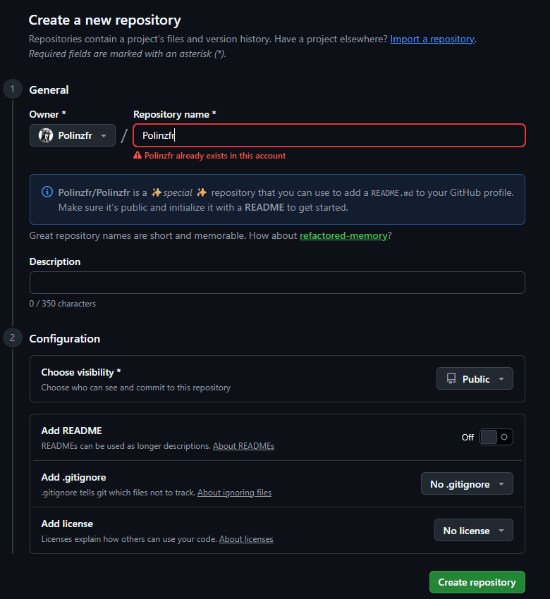
</p>

> [!TIP]
> If your profile README isn't showing up, the three most common causes are: the repo isn't public, the repo name doesn't exactly match your username, or the README file is empty. See the [FAQ](#-faq) for the full checklist.

For a **repository README** (project documentation, not a profile), the fast path is different: start from a template that covers *what the project is*, *how to install it*, *how to use it*, and *how to contribute* — see [README Design Principles](#-readme-design-principles).

---

## 📊 Difficulty Legend

Used throughout this guide to rate each tool and technique.

| Symbol | Level | Meaning |
|---|---|---|
| 🟢 | Beginner | Copy-paste a Markdown/URL snippet, no setup |
| 🟡 | Intermediate | Requires configuration, query parameters, or an account |
| 🟠 | Advanced | Requires a workflow file, API token, or self-hosting |
| 🔴 | Expert | Requires writing custom code (Actions, scripts, SVG) |

## ⏰ Estimated Setup Time

| Tool / Technique | Time |
|---|---|
| Shields.io badge | 1–2 minutes |
| capsule-render banner | 2–5 minutes |
| Readme Typing SVG | 3–5 minutes |
| GitHub Readme Stats card | 2–5 minutes |
| Streak Stats card | 2–5 minutes |
| Simple Icons badge set | 5–10 minutes |
| Full profile generator | 5–15 minutes |
| Contribution snake (GitHub Action) | 15–30 minutes |
| Custom WakaTime / Actions pipeline | 30–90 minutes |

---

## 📂 Tool Categories

| Category | What it covers | Tools in this guide |
|---|---|---|
| **Badges** | Small status/metadata pills | Shields.io, Simple Icons |
| **Banners & Headers** | Decorative section dividers | capsule-render |
| **Animated Text** | Typing/deleting text effects | Readme Typing SVG |
| **Live Stats Widgets** | Auto-updating SVG stat cards | GitHub Readme Stats, Streak Stats |
| **Full Generators** | Guided builders that combine several tools | GitHub Profile README Generator |
| **Automation / Actions** | Scheduled workflows that rewrite your README | Contribution Snake, Contribution Painter |

---

## 🧭 Beginner Roadmap

If you've never customized a README before, follow this order — each step builds on the last and takes under 15 minutes.

1. **Write real content first.** Before any tool, draft your bio/project description in plain text. Design later.
2. **Add a badge row** with [Shields.io](#1-shieldsio) for your top 5–8 technologies.
3. **Add a header banner** with [capsule-render](#2-capsule-render).
4. **Add one stats card** with [GitHub Readme Stats](#4-github-readme-stats).
5. **Preview on GitHub** (not just a local Markdown viewer — GitHub's renderer has quirks).
6. **Only then** consider animation, streak cards, or Actions-based automation.

> [!WARNING]
> Skipping step 1 is the single most common cause of a README that looks impressive but says nothing. A wall of badges above an empty bio helps no one.

---

## 🎓 Recommended Learning Path

| Stage | Focus | Outcome |
|---|---|---|
| 1. Markdown fundamentals | Headings, lists, links, images, tables | Can write clean structural content |
| 2. GitHub Flavored Markdown | Callouts, task lists, footnotes, collapsible sections | Can write GitHub-native docs |
| 3. Static badges | Shields.io basics | Can add tech-stack and status badges |
| 4. Dynamic widgets | Stats cards, streak cards | Can add auto-updating content |
| 5. HTML-in-Markdown | `<details>`, `<picture>`, alignment via `<div>` | Can control layout GitHub's Markdown alone can't |
| 6. Automation | GitHub Actions that regenerate README content | Can build self-updating profiles |

---

## 🧰 Core Tools — Deep Dives

### 1. Shields.io

**Difficulty:** 🟢 Beginner · **Setup Time:** 1–2 minutes

#### Quick Summary
A badge-generation service. You build a URL, GitHub renders it as an image, and the badge updates automatically because it's not a static file — it's a live-generated SVG.

#### Overview
Shields.io is the badge standard on GitHub. It renders concise, consistent SVG/PNG badges and integrates with dozens of package registries, CI providers, and static data sources. It's used across an enormous share of popular open-source repositories to show build status, version, license, and download counts at a glance.

#### Purpose
To communicate small pieces of status or metadata (build passing, license type, latest version, language, download count) in a compact, scannable, visually consistent format — and, in profile READMEs, to build tech-stack rows.

#### Main Features
- Dozens of supported services (npm, PyPI, Docker Hub, GitHub Actions, Codecov, etc.)
- Static badges for arbitrary label/message/color combinations
- Logo support via [Simple Icons](#6-simple-icons) slugs
- Multiple visual styles: `flat`, `flat-square`, `plastic`, `for-the-badge`, `social`
- No account or API key required for basic use

#### Official Website
https://shields.io

#### GitHub Repository
https://github.com/badges/shields

#### Requirements
None. It's a hosted service — you only need a Markdown or HTML `` tag.

#### Installation
Nothing to install. Construct a URL and embed it:

```md

```

#### Complete Walkthrough

**Step 1 — Decide what the badge should communicate.** Status? Version? A tech stack item? Each has a slightly different URL pattern.

**Step 2 — For a static badge**, use the pattern:
```
https://img.shields.io/badge/<LABEL>-<MESSAGE>-<COLOR>
```
Example:
```md

```

<p align="center">
  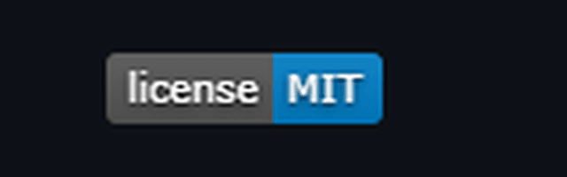
</p>

**Step 3 — For a service-linked badge** (auto-updating), use the shields.io badge builder or the documented endpoint for that service, e.g., npm version:
```md

```

**Step 4 — Add a logo.** Append `&logo=` with a Simple Icons slug:
```md

```

<p align="center">
  
</p>

**Step 5 — Pick a consistent style** across all badges in the README — mixing `flat` and `for-the-badge` in the same row looks unintentional.

**Step 6 — Group badges logically** (build status together, tech stack together, socials together) with a line break between groups.

#### Best For
Tech-stack rows, build/license/version status on project READMEs, social/contact link rows on profile READMEs.

#### Advantages
- Zero setup, instant results
- Extremely wide service coverage
- Consistent visual language recognized across GitHub
- Scales from one badge to fifty without extra tooling

#### Disadvantages
- Overuse creates visual noise fast
- Custom colors require hex codes, which is a small friction point for beginners
- Static badges don't update — easy to forget and let them go stale
- Some registries rate-limit shields.io's proxy under heavy traffic

#### Pro Tips
1. Keep one style (`flat-square` is the most common modern default) across the whole document.
2. Limit a single badge row to 6–8 badges before wrapping to a new row.
3. Use `logoColor=white` on dark badge backgrounds for contrast.
4. Wrap each badge in a link back to the relevant tool or profile using `[![...]](url)`.
5. Use static badges for anything that won't change (license, "made with X"); use service badges for anything that should (version, build status).
6. Match badge color to brand color where one exists (e.g., official brand hex from Simple Icons) for a more polished, intentional look.
7. Avoid `for-the-badge` style in dense rows — it's large and works better for one or two hero badges.
8. Test badges in both GitHub light and dark theme before finalizing.
9. Use `?style=flat-square&labelColor=...` to theme a whole badge set at once.
10. Don't badge things nobody will click — a badge should either communicate status at a glance or link somewhere useful.

#### Common Mistakes
1. Mixing multiple badge styles in one document.
2. Using default red/green/blue for everything instead of a coherent palette.
3. Badging every technology ever touched instead of the current stack.
4. Forgetting `logoColor` so the logo is invisible on a dark badge.
5. Leaving badges unlinked when a documentation link would add value.
6. Using huge badge rows above any actual content.
7. Copy-pasting badge markdown without updating the username/repo in the URL.
8. Using shields.io for large images instead of small status indicators.
9. Not checking badge rendering after GitHub Markdown updates.
10. Stacking 20+ badges vertically instead of grouping into rows.

#### Related Tools
[Simple Icons](#6-simple-icons) (for logos), [capsule-render](#2-capsule-render) (for banners), [shieldcn](https://shieldcn.dev) (shadcn-styled alternative badge/chart generator).

#### Alternatives
- **Badgen** — a lighter, faster badge service with a similar API shape.
- **shieldcn** — shadcn/ui-styled badges and charts, including star-history and download charts as portable SVGs.

#### Comparison

| Tool | Style | Speed | Customization |
|---|---|---|---|
| Shields.io | Flat/plastic/for-the-badge | Fast, widely cached | High (colors, logos, styles) |
| Badgen | Minimal flat | Fast | Moderate |
| shieldcn | shadcn-inspired | Fast | High, plus charts |

#### Real World Use Cases
- Build/CI status on an open-source library's README.
- A "PRs Welcome" badge on a contribution-friendly repo.
- A tech-stack badge row on a profile README.
- Download-count badges on npm/PyPI packages to signal adoption.

#### Customization Ideas
- Build a badge row themed to match your banner's color palette.
- Use `label=` with an emoji for a playful, personal profile touch.
- Create a "currently learning" badge row separate from your core stack.

#### FAQ

**Q: Do badges slow down my README?**
A: Negligibly — they're small, cached SVGs, but dozens of badges do add real HTTP requests, so keep counts sane.

**Q: Can I self-host Shields.io?**
A: Yes, the repository is open source and includes self-hosting instructions, useful for internal/private ecosystems.

**Q: Will a static badge ever look outdated?**
A: Yes — static badges never change unless you edit them, so use dynamic/service badges for anything that should track reality (like version numbers).

#### Final Verdict
Shields.io is close to mandatory for any well-designed README. It's low-effort, high-payoff, and has essentially universal GitHub support. The only skill required is restraint.

---

### 2. capsule-render

**Difficulty:** 🟢 Beginner · **Setup Time:** 2–5 minutes

#### Quick Summary
Generates decorative SVG banners — waves, slices, gradients — used as header and footer dividers in profile READMEs.

#### Overview
capsule-render is a small hosted API that renders a customizable SVG "capsule" shape (wave, rounded rectangle, cylinder, and more) with your text overlaid, driven entirely by URL query parameters. It's become one of the most recognizable visual signatures of a "designed" GitHub profile.

#### Purpose
To give a profile README a clear visual header and footer without needing any image-editing skill — purely through a query string.

#### Main Features
- Multiple shapes: `waving`, `rect`, `slice`, `egg`, `shark`, `cylinder`, `soft`, `venom`, `rounded`, `blur`, `speech`
- Solid or gradient color fills
- Configurable text, font size, height, and animation speed
- Section positioning (`header` or `footer`) so the shape can be flipped for a bottom banner

#### Official Website / Repository
https://github.com/kyechan99/capsule-render

#### Requirements
None — hosted service, single image URL.

#### Installation
Not applicable. Embed directly:

```md

```

#### Complete Walkthrough

**Step 1 — Pick a shape** that matches your desired tone: `waving` for friendly/casual, `rect` or `soft` for minimal/professional, `venom` or `shark` for a bold, playful profile.

<p align="center">
  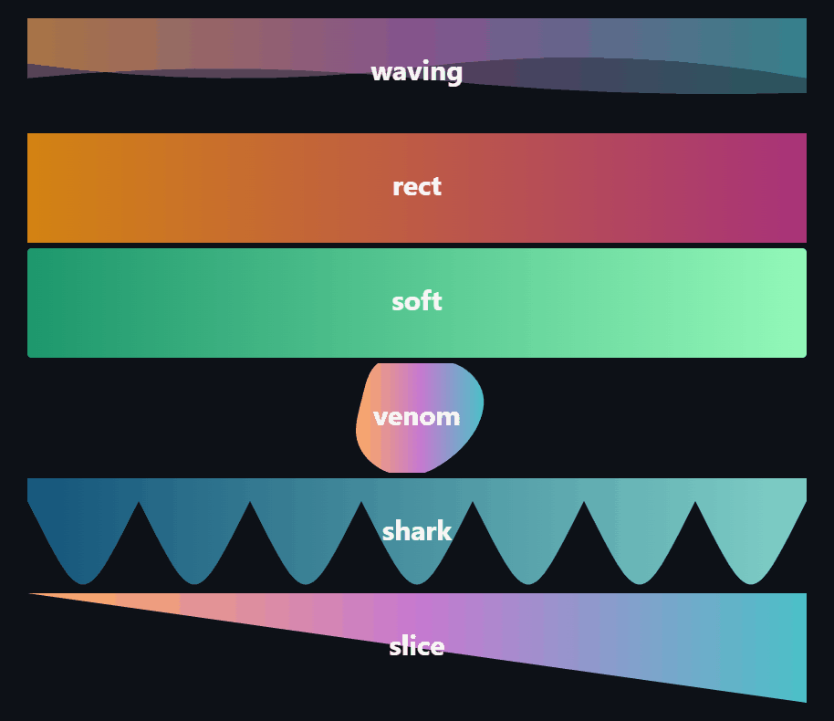
</p>

**Step 2 — Set color.** Use a named color, hex code, or `color=gradient` (customizable via `customColorList`) for a smoother visual.

**Step 3 — Add your text** via `text=` (URL-encode spaces as `%20` or `+`).

**Step 4 — Tune height and font size** so the text isn't cramped — `height=200` to `300` with `fontSize=60` to `80` is a common comfortable range.

<p align="center">
  
</p>

**Step 5 — Duplicate for a footer**, setting `section=footer` and often a flipped/reversed shape so the header and footer visually bookend the page.

#### Best For
Profile README headers/footers; occasionally used as section dividers inside longer project READMEs.

#### Advantages
- No design tooling required
- Fully URL-driven, so instantly editable
- Wide shape/color variety
- Renders reliably on GitHub's Markdown image pipeline

#### Disadvantages
- Overused shapes (especially default rainbow `waving`) can look generic
- Large banners can dominate a profile and push real content below the fold
- Limited typography control compared to a designed image
- Adds an external HTTP dependency to your README's rendering

#### Pro Tips
1. Match banner color to your badge palette for a cohesive look.
2. Keep header height proportional — oversized banners push content below the fold on mobile.
3. Use `animation=twinkling` or similar sparingly; too much motion is distracting, not impressive.
4. A matching, flipped footer banner gives the page a designed, intentional close.
5. Avoid default rainbow gradients unless that's a deliberate brand choice — they're the most recognizable "default" look.
6. Test the banner at actual GitHub profile width, not just the raw image.
7. Keep header text short — long strings shrink unpredictably or wrap oddly.
8. Use `fontAlignY` to fine-tune vertical centering when text looks off.
9. Consider `soft` or `rounded` types for a more corporate/professional profile.
10. Cache-bust during editing by changing a parameter slightly if GitHub shows a stale image.

#### Common Mistakes
1. Using an oversized banner that pushes your bio and pinned projects off-screen.
2. Choosing a shape/animation combination that clashes with a minimal profile.
3. Forgetting to URL-encode text with spaces or special characters.
4. Using clashing gradient colors against a dark-theme GitHub background.
5. Not adding a matching footer, leaving the page feeling unfinished.
6. Setting font size too large for the text length, causing clipping.
7. Layering a typing SVG directly on top of a busy banner, making both hard to read.

#### Related Tools
[Readme Typing SVG](#3-readme-typing-svg) (often placed just below the header banner), [Simple Icons](#6-simple-icons).

#### Alternatives
- Custom-designed static PNG/SVG banners (via Figma or Canva) for full creative control.
- **shieldcn** header/banner generator, styled after shadcn/ui, as a more muted alternative.

#### Comparison

| Tool | Control | Effort | Visual Weight |
|---|---|---|---|
| capsule-render | Query-param based | Low | Medium–High |
| Custom PNG/SVG banner | Full design control | High | Fully custom |

#### Real World Use Cases
- Profile README header introducing name/role.
- Section dividers between "About," "Stats," and "Projects" blocks on longer profiles.
- Repository README headers for personal/portfolio projects (less common for serious OSS libraries).

#### Customization Ideas
- Use your primary badge accent color as the banner's solid fill for brand consistency.
- Pair a `soft` header with a `rect` footer in the same color for symmetry without repetition.

#### FAQ

**Q: Does capsule-render work in repository READMEs, not just profiles?**
A: Yes, it's just an image URL — it works anywhere Markdown images render, though it's most common on profile READMEs.

**Q: Can I self-host it?**
A: The project is open source, so yes, though the hosted Vercel endpoint is what nearly everyone uses.

#### Final Verdict
The fastest way to make a profile README look designed rather than default. Use it with restraint — one clear header (and optionally a matching footer) beats banners scattered throughout the page.

---

### 3. Readme Typing SVG

**Difficulty:** 🟢 Beginner · **Setup Time:** 3–5 minutes

#### Quick Summary
Generates an animated SVG that types and deletes a sequence of lines, commonly used as a personal tagline under a profile header.

#### Overview
Built by DenverCoder1, this tool renders a self-contained animated SVG (no JavaScript required on your end) that cycles through a list of strings with a typewriter effect. It's one of the most widely adopted personalization widgets on profile READMEs.

#### Purpose
To add a dynamic, attention-drawing line (a rotating set of taglines, roles, or interests) directly beneath a name/header.

#### Main Features
- Multiple lines that cycle automatically
- Configurable font, size, color, and background
- Adjustable typing/deletion/pause speed
- Center alignment and width/height control
- Fully URL-parameter driven, no account needed

#### Official Website / Repository
https://github.com/DenverCoder1/readme-typing-svg

#### Requirements
None.

#### Installation
Embed as an image:

```md
[](https://git.io/typing-svg)
```

#### Complete Walkthrough

**Step 1 — Draft 2–4 short lines.** Each should read naturally on its own — think rotating subtitle, not a paragraph.

**Step 2 — Set `lines=`** with entries separated by `;`, URL-encoded.

<p align="center">
  
</p>

**Step 3 — Tune `font`, `size`, and `color`** to match your header banner's palette.

**Step 4 — Set `center=true`** if your header layout is centered (common in profile READMEs using HTML `<div align="center">`).

**Step 5 — Adjust `pause` and `duration`** so the reading pace feels natural — too fast is unreadable, too slow feels sluggish.

<p align="center">
  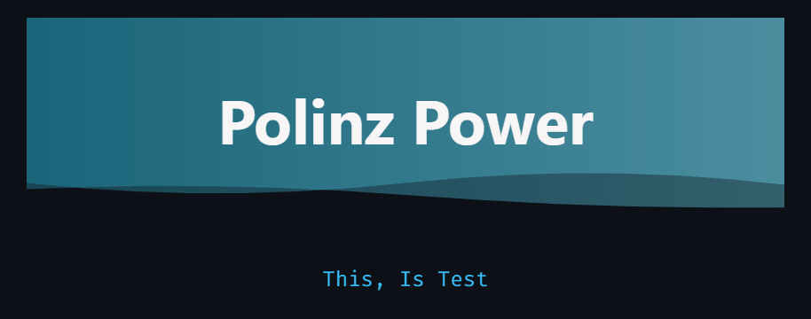
</p>

#### Best For
The line directly under a profile header banner — name, role, or rotating interests.

#### Advantages
- Adds motion and personality without any code
- Fully self-contained SVG, no GitHub Action needed
- Highly configurable typography
- Small file size, fast to render

#### Disadvantages
- Animated GIFs/SVGs can be distracting in a text-heavy README
- Doesn't render in some third-party Markdown viewers (README aggregators, some IDEs)
- Screen readers may announce alt text awkwardly for animated content
- Overuse (multiple typing SVGs on one page) looks chaotic

#### Pro Tips
1. Keep to one typing SVG per page — it's meant to be a singular focal point.
2. Match `color` to your banner's accent color, not a random default.
3. Use short, punchy lines — under ~40 characters reads best.
4. Set a matching `background` (or transparent) so it blends with GitHub's theme.
5. Pair with `center=true` and an HTML `<div align="center">` wrapper for a polished hero section.
6. Avoid overly long line lists — 3–4 rotating lines is the sweet spot.
7. Preview in both light and dark GitHub themes since text color doesn't auto-adjust.
8. Don't put critical information only in the typing SVG — assume some viewers won't see the animation.
9. Slow `pause` slightly if lines contain longer phrases.
10. Use it for personality (roles, interests) rather than data that changes often — it's static text, not a live feed.

#### Common Mistakes
1. Using color that's invisible against light or dark GitHub backgrounds.
2. Cramming too many rotating lines, so the point never lands.
3. Forgetting `center=true` while everything else on the page is centered.
4. Not URL-encoding special characters, breaking the query string.
5. Placing two or more typing SVGs on the same page.
6. Using it for information that needs to be immediately scannable (e.g., contact email).

#### Related Tools
[capsule-render](#2-capsule-render) (usually placed directly above it).

#### Alternatives
- Static bold tagline text (more accessible, less flashy).
- Custom animated SVG built by hand for full creative control.

#### Comparison

| Approach | Motion | Accessibility | Effort |
|---|---|---|---|
| Readme Typing SVG | Yes | Moderate | Very low |
| Static tagline | No | High | Trivial |

#### Real World Use Cases
- "Full-stack developer \| Open source enthusiast \| Currently learning Rust" rotating under a name header.
- A rotating list of current focus areas on a portfolio-style profile.

#### Customization Ideas
- Rotate between languages you speak as a fun, personal touch.
- Sync the color to whichever theme (dracula, tokyonight, etc.) your stats cards use.

#### FAQ

**Q: Does it cost anything?**
A: No, it's a free hosted service backed by an open-source repository.

**Q: Can I use a custom font?**
A: Yes, within the set of supported Google Fonts exposed by the `font` parameter.

#### Final Verdict
A small, low-effort addition that adds noticeable personality to a profile header. Use exactly one, keep it short, and match its palette to the rest of the page.

---

### 4. GitHub Readme Stats

**Difficulty:** 🟡 Intermediate · **Setup Time:** 2–5 minutes (longer if self-hosting)

#### Quick Summary
Generates dynamic SVG cards showing GitHub stats — stars, commits, PRs, issues, and a "top languages" breakdown — that update automatically every time the card is viewed.

#### Overview
Built by Anuraghazra, this is the most widely used GitHub stats card generator, with tens of thousands of stars on its own repository. It queries GitHub's API server-side and renders an SVG card, so the numbers on your profile are always current with zero maintenance on your part.

#### Purpose
To show real, live activity data (rather than a static claim) directly in a profile README, adding credibility and a sense of an active account.

#### Main Features
- Stats card: stars, commits, PRs, issues, contributed-to count, and a computed rank
- Top Languages card: a breakdown of language usage by bytes across repositories
- Repo pin cards: a compact card highlighting a specific pinned repository
- Built-in themes (dracula, tokyonight, radical, gruvbox, and more)
- Extensive query-parameter customization (hide specific stats, custom colors, border radius, icons)

#### Official Website / Repository
https://github.com/anuraghazra/github-readme-stats

#### Difficulty Notes
Basic embedding is 🟢 beginner-level (one Markdown line). Self-hosting your own instance (needed for private-repo stats or to avoid the shared instance's rate limits) is 🟠 advanced.

#### Requirements
None for the public hosted instance. A personal GitHub token and your own Vercel deployment if self-hosting.

#### Installation

Basic (hosted instance):
```md

```

Self-hosted (optional, advanced): fork the repository, deploy to Vercel, add a `PAT_1` environment variable with a personal access token, then point the image URL at your own deployment domain.

#### Complete Walkthrough

**Step 1 — Embed the basic stats card** with your username, and set `show_icons=true` for a more polished layout.

<p align="center">
  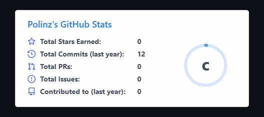
</p>

**Step 2 — Pick a theme** matching your palette, e.g., `&theme=tokyonight`.

**Step 3 — Hide stats you don't want shown** with `&hide=` (e.g., hide `stars` if it's not flattering yet, though transparency is usually the better call).

**Step 4 — Add the Top Languages card** on a second line:
```md

```

<p align="center">
  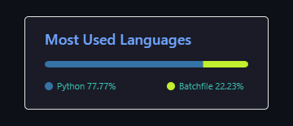
</p>

**Step 5 — (Optional) Pin a specific repository** using the `/api/pin` endpoint to spotlight one project.

**Step 6 — (Optional, advanced) Self-host** if you want private-repository contributions counted, or if the shared instance is rate-limited during peak hours.

<p align="center">
  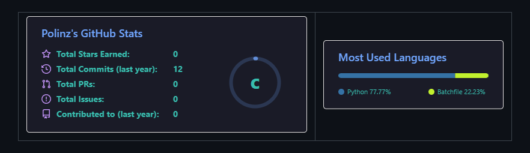
</p>

#### Best For
Profile READMEs where you want a credible, auto-updating snapshot of activity rather than a hand-written claim.

#### Advantages
- Always current — zero maintenance once embedded
- Wide theming support that matches most profile color schemes
- Strong social proof for genuinely active accounts
- Well-documented, huge community, actively maintained

#### Disadvantages
- The shared public instance can be slow or rate-limited under heavy load
- Doesn't count private contributions unless self-hosted with a token
- Can be discouraging for newer accounts with low numbers — visible metrics aren't always a positive
- Adds noticeable visual weight; needs deliberate placement, not just appended at the end

#### Pro Tips
1. Use `layout=compact` for Top Languages when you have many languages — the default layout can run very tall.
2. Set `hide_border=true` for a more minimal look if your GitHub theme already provides a border via `<div>` styling.
3. Match `theme=` across stats card, streak card, and typing SVG for a coherent visual identity.
4. Consider self-hosting if you're on a team where multiple profiles hit the same public instance heavily.
5. Use `include_all_commits=true` cautiously — it changes the commit count basis and can look inconsistent if only some viewers know what it means.
6. Place the stats card after your bio, not before — lead with who you are, not a number.
7. Don't chase a specific "rank" letter; it's a rough heuristic, not a meaningful credential.
8. Use `count_private=true` only when self-hosted with your own token, otherwise it silently has no effect.
9. Align stats and top-languages cards side-by-side using an HTML table or flex `<div>` for a cleaner layout.
10. Revisit your theme choice whenever GitHub ships new light/dark theme variants, to avoid clashing.

#### Common Mistakes
1. Stacking five or more stat/utility cards vertically with no visual grouping.
2. Using a theme that clashes with GitHub's default light mode for viewers who haven't switched to dark mode.
3. Setting `include_all_commits=true` without understanding it changes what the number represents.
4. Assuming private contributions are counted on the shared public instance (they aren't).
5. Leaving default theme when everything else on the profile is custom-colored.
6. Placing the card above the bio so a visitor sees numbers before context.
7. Not checking mobile rendering — wide side-by-side card layouts can overflow on small screens.

#### Related Tools
[GitHub Readme Streak Stats](#5-github-readme-streak-stats) (commonly paired), [capsule-render](#2-capsule-render) for framing.

#### Alternatives
- **readme-generator** infographics tools with 30+ plugins for stats output in SVG/Markdown/PDF/JSON.
- Manually written "Currently working on" sections for developers who prefer not to display metrics at all.

#### Comparison

| Tool | Live Data | Setup | Customization |
|---|---|---|---|
| GitHub Readme Stats | Yes | 🟡 | High |
| Manual "Now" section | No | 🟢 | Full (it's just text) |

#### Real World Use Cases
- Signaling active open-source contribution history to recruiters browsing a profile.
- Showing top languages to quickly communicate a stack focus (e.g., mostly Python and Go).
- Highlighting a single flagship project via the pin card on an otherwise minimal profile.

#### Customization Ideas
- Build a two-column HTML table with the stats card on the left and top-languages on the right.
- Theme the card to exactly match your capsule-render header's color for visual continuity.

#### FAQ

**Q: Why are my private contributions not showing?**
A: The shared public instance never counts private contributions; you need to self-host with your own token and `count_private=true`.

**Q: Why is the card slow to load sometimes?**
A: The public instance serves an enormous number of profiles and can be rate-limited or briefly overloaded during peak hours — self-hosting avoids this.

#### Final Verdict
The single most impactful "dynamic" addition to a profile README. Worth the small setup effort, especially paired with a matching theme across other widgets.

---

### 5. GitHub Readme Streak Stats

**Difficulty:** 🟢 Beginner · **Setup Time:** 2–5 minutes

#### Quick Summary
Displays your current contribution streak, longest streak, and total contributions as a themeable SVG card.

#### Overview
Also built by DenverCoder1, this tool complements GitHub Readme Stats by focusing specifically on contribution consistency rather than raw totals — a different, often more motivating signal.

#### Purpose
To visually reward and display contribution consistency, which many developers find more meaningful (and more encouraging to maintain) than raw star/commit counts.

#### Main Features
- Current streak, longest streak, and total contributions in one card
- Theming that matches GitHub Readme Stats' theme names for consistency
- Custom date-range support
- Border radius, background, and font customization

#### Official Website / Repository
https://github.com/DenverCoder1/github-readme-streak-stats

#### Requirements
None for basic use.

#### Installation
```md

```

#### Complete Walkthrough

**Step 1 — Embed the card** with your username.

<p align="center">
  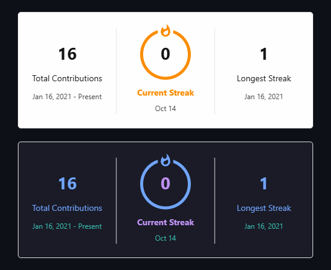
</p>

**Step 2 — Match the theme** to your GitHub Readme Stats card for visual consistency.

**Step 3 — (Optional) Set a custom date range** with `&date_format=` if you want the streak calculated against a specific window.

<p align="center">
  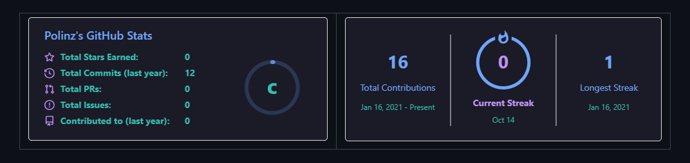
</p>

**Step 4 — Place it directly beside or below the main stats card**, not scattered elsewhere on the page.

#### Best For
Profiles that want to emphasize consistency and habit over raw volume — especially motivating for developers building a daily coding habit.

#### Advantages
- Encourages a genuinely good habit (regular contributions)
- Visually distinct from the stats card, avoiding redundancy
- Matches the same theme library as GitHub Readme Stats

#### Disadvantages
- Can create unhealthy pressure to "keep the streak alive" with low-value commits
- Same shared-instance rate-limit caveats as other Vercel-hosted widgets
- Streaks reward frequency, not quality — can misrepresent actual impact

#### Pro Tips
1. Use the same `theme=` value as your stats card for visual continuity.
2. Don't let a streak counter push you toward meaningless commits just to avoid breaking it — the card should reflect real work.
3. Pair it directly next to (not below) the main stats card in a two-column layout.
4. Consider omitting this card if your contribution pattern is intentionally non-daily (e.g., you batch work) — it can look worse than it is.
5. Use `hide_border=true` if your layout already frames cards with a custom `<div>` border.

#### Common Mistakes
1. Mismatched theme between the streak card and the main stats card.
2. Displaying it prominently while having a long-broken streak, drawing attention to the wrong thing.
3. Treating it as the headline metric instead of a supporting detail.

#### Related Tools
[GitHub Readme Stats](#4-github-readme-stats).

#### Alternatives
A written "how I work" note, which sidesteps the pressure a visible streak counter can create.

#### Comparison

| Tool | Signals | Risk |
|---|---|---|
| Streak Stats | Consistency | Can encourage low-value commits |
| Readme Stats | Volume & activity | Can favor quantity over quality |

#### Real World Use Cases
Developers documenting a "100 days of code"-style personal challenge; profiles built around consistent daily learning.

#### Customization Ideas
Combine with a written note about your working rhythm (e.g., "I batch commits weekly" ) so the card is read in context rather than as the whole story.

#### FAQ

**Q: Does it count private contributions?**
A: Only with the appropriate self-hosted/token setup, same caveat as GitHub Readme Stats.

#### Final Verdict
A nice, optional complement to the main stats card — skip it if streak pressure isn't a healthy motivator for you personally.

---

### 6. Simple Icons

**Difficulty:** 🟢 Beginner · **Setup Time:** 5–10 minutes (for a full badge set)

#### Quick Summary
A library of 3,000+ free SVG icons for brands and technologies, used as the `logo=` source for Shields.io badges and standalone icon embeds.

#### Overview
Simple Icons standardizes brand icons (React, Python, Docker, PostgreSQL, and thousands more) with consistent slugs and official brand colors, making it the de facto icon source for tech-stack badges across GitHub.

#### Purpose
To give badges and icon rows a recognizable, consistent, on-brand look instead of generic or mismatched icons.

#### Main Features
- Thousands of brand/technology icons, each with an official hex color
- Consistent slug naming for easy lookup
- CDN-hosted SVGs usable directly, or via Shields.io's `logo=` parameter
- Searchable icon directory on the website

#### Official Website
https://simpleicons.org

#### GitHub Repository
https://github.com/simple-icons/simple-icons

#### Requirements
None.

#### Installation
No install needed for badge use — reference the slug directly:
```md

```

#### Complete Walkthrough

**Step 1 — Find your technology's slug** on simpleicons.org (usually the lowercase name, e.g., `postgresql`, `nextdotjs`).

**Step 2 — Note the official brand hex color** shown on the icon's detail page.

<p align="center">
  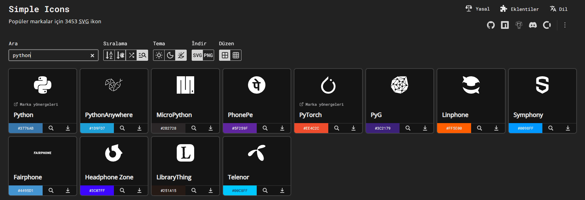
</p>

**Step 3 — Build a Shields.io badge** using `logo=<slug>` and the official hex as the badge background.

**Step 4 — Choose `logoColor`** (usually white or black) for contrast against that background.

**Step 5 — Repeat for your full stack**, keeping the badge style identical across all of them.

<p align="center">
  
</p>

#### Best For
Building a consistent, on-brand tech-stack badge row.

#### Advantages
- Official, accurate brand colors — no guessing hex codes
- Enormous coverage of modern tools and languages
- Free, open source, MIT-licensed
- Works seamlessly with Shields.io

#### Disadvantages
- Some very new or niche tools may not have an icon yet
- Slug names aren't always intuitive (small lookup friction)
- Using every available icon for every tool you've ever touched creates clutter, not clarity

#### Pro Tips
1. Always use the official brand hex from the icon page rather than an approximate color.
2. Keep icon style (all badges, or all standalone icons) consistent — don't mix formats.
3. Curate your stack row to 8–12 core technologies, not every tool you've ever opened.
4. Group icons by category (languages, frameworks, tools, cloud) with subtle headers.
5. Check for updated/rebranded logos periodically — brand colors do change over time.

#### Common Mistakes
1. Guessing a hex color instead of using the official one, producing an off-brand look.
2. Using an outdated slug name after a project renamed itself.
3. Including every technology ever used instead of the current, relevant stack.
4. Mismatched `logoColor` making the icon invisible.

#### Related Tools
[Shields.io](#1-shieldsio) (primary consumer of Simple Icons).

#### Alternatives
Devicon (another popular tech-icon set, more animation-friendly for some presentation styles).

#### Comparison

| Tool | Coverage | Color Accuracy | Format |
|---|---|---|---|
| Simple Icons | Very broad | Official brand hex | SVG |
| Devicon | Broad, dev-tool focused | Approximate | SVG/Font |

#### Real World Use Cases
Tech-stack badge rows, "tools I use" sections, and social/contact icon rows (many social platforms are included too).

#### Customization Ideas
Build a themed row where every badge shares one background shade but each retains its brand-colored icon, for a more restrained, professional look.

#### FAQ

**Q: Is Simple Icons free for commercial/professional profiles?**
A: Yes, it's open source under a permissive license.

#### Final Verdict
The missing piece that makes Shields.io badges look intentional rather than generic. Always prefer it over guessed colors.

---

### 7. GitHub Profile README Generator

**Difficulty:** 🟢 Beginner · **Setup Time:** 5–15 minutes

#### Quick Summary
A form-based web tool that combines several of the widgets above (badges, stats, typing text, social links) into one generated README, without writing any Markdown by hand.

#### Overview
Several community-built generators exist; the best known is `gh-profile-readme-generator` by Rahul Jain. You fill in fields — name, bio, skills, social links — and the tool outputs complete, ready-to-paste Markdown.

#### Purpose
To lower the barrier to entry for a polished profile README for developers who don't want to hand-assemble badge URLs and widget parameters individually.

#### Main Features
- Guided form covering bio, skills, socials, and support links
- Live preview before copying the generated Markdown
- Combines Shields.io, GitHub Readme Stats, and social badges automatically
- No account required

#### Official Website
https://rahuldkjain.github.io/gh-profile-readme-generator/

#### Requirements
None — browser-based tool.

#### Installation
No installation — it's a web app; you copy the output into your README.

#### Complete Walkthrough

**Step 1 — Open the generator** and fill in your name and a short bio.

<p align="center">
  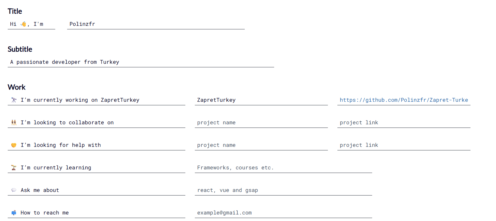
</p>

**Step 2 — Select your skills** from the provided icon list.

**Step 3 — Add social links** (Twitter/X, LinkedIn, personal site, etc.).

**Step 4 — Enable optional widgets** like GitHub stats or a support/donation badge.

<p align="center">
  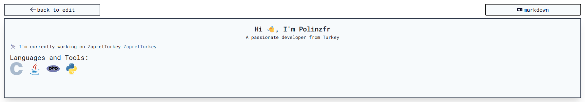
</p>

**Step 5 — Copy the generated Markdown** and paste it into your profile repository's README.

**Step 6 — Manually edit afterward** — treat the output as a strong starting draft, not a final product; personalize wording and trim anything generic.

#### Best For
Absolute beginners who want a complete, working profile README in minutes without learning badge syntax first.

#### Advantages
- Extremely fast path to a "done" profile
- Combines multiple tools correctly out of the box
- Good for learning the underlying Markdown patterns by example

#### Disadvantages
- Generated output can look templated if left unedited
- Encourages including every optional field rather than curating
- Less flexible than hand-building once you outgrow the defaults

#### Pro Tips
1. Always edit the generated bio — default phrasing reads as generic to experienced reviewers.
2. Remove sections you don't have real content for (empty "currently learning" placeholders look worse than omitting the section).
3. Re-theme the generated stats cards to match your own color choices rather than leaving defaults.
4. Use the output as a learning reference for badge/widget syntax, then hand-edit going forward.
5. Don't enable every optional badge just because it's available — curate.

#### Common Mistakes
1. Publishing the generated output completely unedited.
2. Leaving placeholder text like default bio phrasing in place.
3. Enabling every widget offered instead of the ones relevant to you.
4. Not verifying that social links actually point to your accounts, not the generator's example.

#### Related Tools
Everything above — this tool is a wrapper around Shields.io, Simple Icons, and GitHub Readme Stats.

#### Alternatives
Hand-building the README using this guide's individual tool sections, for full control from the start.

#### Comparison

| Approach | Speed | Uniqueness | Learning Value |
|---|---|---|---|
| Generator | Fastest | Lower (unless edited) | Moderate |
| Hand-built | Slower | High | High |

#### Real World Use Cases
A quick, respectable profile README for a developer setting one up for the first time, e.g., before a job search or hackathon.

#### Customization Ideas
Use the generator to scaffold, then manually swap in a custom capsule-render banner and a curated Simple Icons badge row.

#### FAQ

**Q: Is the generated README considered "cheating" or unoriginal?**
A: No — plenty of well-regarded profiles started from a generator and were then personalized. The key is editing it into something specific to you.

#### Final Verdict
An excellent on-ramp, not a final destination. Use it to learn the patterns, then graduate to hand-building the sections you care most about.

---

### 8. Contribution Snake / Contribution Painter

**Difficulty:** 🔴 Expert (Snake) / 🟠 Advanced (Painter) · **Setup Time:** 15–30 minutes

#### Quick Summary
Two different automation-driven visual effects: the **contribution snake** animates a "snake" eating through your contribution graph via a scheduled GitHub Action; **Contribution Painter** lets you design pixel art and generates backdated commits to "paint" it onto your contribution graph.

#### Overview
Both rely on GitHub Actions and, in Contribution Painter's case, direct manipulation of commit history/dates — meaningfully more advanced than any embed-a-URL tool above.

#### Purpose
Snake: a purely decorative, regularly-updating animation over your real contribution graph. Painter: a way to intentionally design (rather than organically produce) a pattern in your contribution graph.

#### Main Features

**Contribution Snake:**
- GitHub Action that runs on a schedule (e.g., daily)
- Generates an animated SVG "snake" that eats your contribution squares
- Outputs both light and dark theme variants automatically

**Contribution Painter:**
- Interactive canvas for designing pixel art
- Generates the backdated commits needed to render that art in your contribution graph
- Supports intensity levels and commit multipliers, with multi-language UI

#### Requirements
- A GitHub Actions-enabled repository (works on free tier)
- Comfort editing YAML workflow files
- For Painter: a separate, dedicated repository — this technique fills a contribution graph with synthetic commits and should never be done on a real project repo

#### Installation (Contribution Snake)

**Step 1 — Add a workflow file** (`.github/workflows/snake.yml`) that runs the snake-generation action on a schedule and commits the output SVG to an `output` branch.

**Step 2 — Reference the generated SVG** in your README using a `<picture>` tag with light/dark variants:
```md
<picture>
  <source media="(prefers-color-scheme: dark)" srcset="https://raw.githubusercontent.com/USERNAME/USERNAME/output/github-contribution-grid-snake-dark.svg">
  
</picture>
```

<p align="center">
  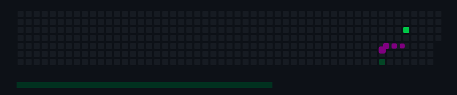
</p>

**Step 3 — Commit and let the Action run** on its schedule; the SVG updates automatically going forward.

#### Complete Walkthrough (Contribution Painter)

> [!CAUTION]
> This technique creates artificial commit history on a real timeline. Use a dedicated, clearly-labeled repository for this — never your primary project history — and understand that some viewers consider a painted graph a form of misrepresenting activity. Transparency about it being decorative is strongly recommended.

**Step 1 — Design your pattern** on the tool's interactive canvas.

**Step 2 — Configure intensity and commit multipliers** to control how "dark" each painted square appears.

**Step 3 — Authenticate and let the tool push backdated commits** to a dedicated repository via the GitHub REST API.

**Step 4 — Verify the pattern rendered correctly** on your public profile graph, which can take a short time to refresh.

#### Best For
Developers who want a genuinely eye-catching, "how did they do that" profile element and are comfortable with GitHub Actions/YAML.

#### Advantages
- Extremely high visual novelty — stands out immediately
- Snake variant is fully automated once set up (zero ongoing maintenance)
- Demonstrates real GitHub Actions competency, which is itself a positive signal

#### Disadvantages
- Meaningfully harder to set up than any other tool in this guide
- Contribution Painter can misrepresent activity level if not clearly framed as decorative
- A broken workflow (YAML error, permissions issue) can silently stop updating
- Adds a maintenance surface area other README tools don't have

#### Pro Tips
1. Test the workflow on a private fork before enabling it on your public profile repo.
2. Use `<picture>` with both light and dark SVG variants — a single-theme snake looks broken in the other mode.
3. Set the workflow's schedule to run daily, not more often — there's no benefit to more frequent runs.
4. For Contribution Painter, always use a separate, clearly-labeled repository.
5. Grant the workflow only the minimum permissions it needs (`contents: write` on the output branch).
6. Keep a copy of the working YAML elsewhere in case you need to reset it after a GitHub Actions syntax change.
7. Watch the Actions tab after setup to confirm the first scheduled run actually succeeds.
8. Don't chain too many scheduled Actions against the same repo — failures become harder to debug.
9. Disclose that a painted graph is decorative if you use Contribution Painter, especially in professional contexts.
10. Revisit and update the Action periodically — unmaintained community Actions occasionally break with platform changes.

#### Common Mistakes
1. Forgetting the dark-mode SVG variant, so the snake disappears for dark-theme viewers.
2. Running Contribution Painter on a real project repository instead of a dedicated one.
3. Granting overly broad workflow permissions.
4. Not verifying the first Action run actually succeeded before assuming it's done.
5. Letting a broken workflow silently stop updating for months.
6. Misrepresenting a painted contribution graph as organic activity to reviewers or employers.

#### Related Tools
[GitHub Readme Stats](#4-github-readme-stats), general GitHub Actions ecosystem.

#### Alternatives
Skipping automation entirely and relying on the organic contribution graph GitHub already renders on every profile — often the more credible choice for professional contexts.

#### Comparison

| Tool | Automation | Risk | Payoff |
|---|---|---|---|
| Contribution Snake | Full (scheduled Action) | Low (purely decorative) | High visual novelty |
| Contribution Painter | Manual trigger + Action | Moderate (misrepresentation risk) | Very high novelty |

#### Real World Use Cases
Developer-relations and hackathon-facing profiles where visual novelty is part of the personal brand; less appropriate for conservative/corporate professional contexts.

#### Customization Ideas
Theme the snake's colors to match your other cards' theme name for full visual consistency across the page.

#### FAQ

**Q: Will this affect my real contribution graph or commit history on other repos?**
A: The snake only reads your graph, it doesn't alter it. Contribution Painter, however, does write synthetic commits — confine it to a dedicated repo.

**Q: Does a broken snake workflow hurt my profile?**
A: Only cosmetically — a stale image — but it's worth monitoring so it doesn't quietly stop updating for a long time.

#### Final Verdict
The most advanced, most visually striking tools in this guide, appropriate once you're comfortable with GitHub Actions. Not a beginner's first step — return to this after mastering the earlier tools.

---

## 📐 README Design Principles

> [!IMPORTANT]
> Every tool in this guide is in service of communication. A README's job is to answer a visitor's questions as fast as possible — design should reduce friction, never add decoration for its own sake.

**For repository READMEs**, the core structure that consistently works:

1. **Project name + one-line description** — what it is, immediately.
2. **Badges** — build status, version, license (only the meaningful ones).
3. **Short demo** — a screenshot or GIF above the fold if the project is visual.
4. **Installation** — copy-pasteable commands.
5. **Usage** — a minimal working example.
6. **Configuration/API reference** — as needed, often linked out to full docs.
7. **Contributing** — how to get involved.
8. **License**.

**For profile READMEs**, the core structure that consistently works:

1. **Header banner** (optional but common).
2. **Name and one-line identity** — role, focus, or interest.
3. **Short bio** — 2–4 sentences, real content, not just badges.
4. **Tech stack badges**.
5. **Stats/streak cards** (optional).
6. **Pinned/featured projects** — link out rather than duplicate full descriptions.
7. **Contact/social links**.

Across both, the same principles apply:

- **Lead with substance, follow with decoration.** A visitor should understand the project or the person before seeing a single badge.
- **Consistency beats variety.** One badge style, one theme, one color palette reads as intentional; a grab-bag of styles reads as unfinished.
- **Every element should answer a question.** If a badge, card, or section doesn't help someone understand or use the project/profile, cut it.
- **Design for skimming.** Headings, short paragraphs, and bullet points let a visitor extract what they need in seconds.

---

## 📝 Markdown & GitHub Flavored Markdown Cheat Sheet

| Element | Syntax |
|---|---|
| Heading | `# H1` through `###### H6` |
| Bold | `**bold**` |
| Italic | `*italic*` |
| Strikethrough | `~~text~~` |
| Link | `[text](url)` |
| Image | `` |
| Inline code | `` `code` `` |
| Code block | ```` ```lang ... ``` ```` |
| Blockquote | `> quote` |
| Unordered list | `- item` |
| Ordered list | `1. item` |
| Task list | `- [ ] todo` / `- [x] done` |
| Table | `\| col \| col \|` with a `---` separator row |
| Horizontal rule | `---` |
| Footnote | `Text[^1]` then `[^1]: note` |

**GitHub-specific extensions:**

| Feature | Syntax |
|---|---|
| Callouts | `> [!NOTE]`, `> [!TIP]`, `> [!IMPORTANT]`, `> [!WARNING]`, `> [!CAUTION]` |
| Mentions | `@username` |
| Issue/PR reference | `#123` |
| Emoji shortcodes | `:rocket:` → 🚀 |
| Collapsible section | `<details><summary>Title</summary>Body</details>` |
| Mermaid diagrams | ```` ```mermaid ... ``` ```` |
| Anchor auto-links | Headings get auto-generated `#anchor-links` |

> [!TIP]
> Callouts (`> [!NOTE]` etc.) are one of the highest-value, most underused GitHub Markdown features — they render with a colored icon and label, and instantly draw attention to warnings, tips, or important notices without any custom HTML.

---

## 🧩 HTML Inside Markdown

GitHub's Markdown renderer supports a safe subset of raw HTML, which is useful for layout control Markdown alone can't achieve:

```html
<div align="center">
  
  <h1>Project Name</h1>
</div>
```

Common, safe patterns:

- **Centering:** `<div align="center">...</div>`
- **Side-by-side cards:** an HTML `<table>` with no borders, one widget per cell
- **Collapsible content:** `<details><summary>Click to expand</summary>...</details>`
- **Theme-aware images:** `<picture>` with `<source media="(prefers-color-scheme: dark)">`
- **Sizing images:** `` (Markdown image syntax has no size control)

> [!WARNING]
> Scripts, forms, and many interactive HTML elements are stripped by GitHub's sanitizer for security. Stick to structural/layout tags — don't rely on HTML for anything that needs to execute.

---

## 📁 README Folder Structure & Asset Organization

A clean pattern for repositories with meaningful visual assets:

```
your-repo/
├── README.md
├── docs/
│   └── screenshots/
│       ├── demo.png
│       └── architecture.png
├── .github/
│   └── workflows/
└── assets/
    └── logo.svg
```

- Keep images out of the repository root — a dedicated `docs/` or `assets/` folder keeps the top level scannable.
- Reference images with relative paths (`docs/screenshots/demo.png`) rather than absolute GitHub URLs where possible — relative paths keep working across forks and renamed branches.
- For profile READMEs, a dedicated private/hidden asset host (or the repo's own `assets/` folder) is standard, since profile repos are typically minimal otherwise.

---

## 🌄 Image Optimization

- **Compress before committing.** PNGs and GIFs bloat repository size fast; run them through a compressor (e.g., `pngquant`, `gifsicle`, or an online tool) before adding.
- **Prefer SVG for anything vector-based** (badges, icons, diagrams) — infinitely scalable, tiny file size.
- **Prefer WebP or optimized PNG for screenshots** where SVG isn't applicable.
- **Keep GIFs short and looped**, and consider an MP4/WebM via HTML5 video for longer demos where supported.
- **Set explicit width** via HTML `` to prevent oversized images from dominating the page.
- **Host large media externally** (or via Git LFS) rather than bloating the main repository history with binary assets.

---

## ♿ Accessibility

- **Always write meaningful `alt` text** on every image — ``, not ``.
- **Don't rely on color alone** to convey status (e.g., pair a red badge with the word "failing," not just a red color).
- **Keep animated content optional-feeling** — a typing SVG or snake animation shouldn't carry information unavailable elsewhere in plain text.
- **Maintain heading hierarchy** (`#` → `##` → `###` in order) so screen readers can navigate the document structurally.
- **Ensure sufficient contrast** between badge/banner text and its background, especially with custom hex colors.
- **Use descriptive link text** ("View the installation guide," not "click here").

---

## 📱 Mobile Compatibility & Dark Mode

- **Test at narrow widths.** Side-by-side HTML tables of stats cards can overflow badly on mobile — verify on an actual phone or a narrow browser window.
- **Use `<picture>` with `prefers-color-scheme`** for any banner or diagram that isn't legible in both GitHub themes.
- **Avoid fixed pixel widths near 100%** of a typical desktop viewport; percentage-based widths degrade more gracefully.
- **Check badge/banner text contrast in both themes** — a banner designed only against dark mode can become unreadable in light mode and vice versa.
- **Keep critical content in text**, not solely inside images, since some mobile clients render Markdown images inconsistently.

---

## 🔖 Badge, Banner & Icon Best Practices

- One badge **style** per document (pick flat-square, flat, or for-the-badge and stay consistent).
- One banner **shape family** — don't mix a `waving` header with a `venom` footer.
- Group badges by **purpose** (status, stack, social) with visual separation between groups.
- Use **official brand colors** from Simple Icons rather than approximated hex values.
- Keep banners **proportional** — tall enough to read, short enough not to dominate.
- Icons should be **currently relevant**, not a historical log of every tool ever used.

---

## 🎨 Layout, Typography, Color & White Space

**Layout:** Structure content so the most important information is visible without scrolling — name/project, one-line description, and primary call-to-action (install command, or bio) above the fold.

**Typography:** Markdown gives limited typographic control (headings, bold, italic). Use heading levels deliberately to create a scannable hierarchy rather than for arbitrary size changes.

**Color:** Choose 2–3 core colors (an accent plus neutrals) and apply them consistently across badges, banners, and stat-card themes. A coherent limited palette reads as more professional than a wide, unrelated color spread.

**White space:** Use blank lines between sections and horizontal rules (`---`) sparingly to break up long documents. Dense, unbroken text is the single biggest readability killer in long READMEs.

---

## 🚨 Common README Mistakes

1. Leading with badges instead of an actual description of the project or person.
2. No installation instructions, or instructions that assume undocumented prerequisites.
3. A wall of text with no headings, lists, or breaks.
4. Screenshots that are outdated relative to the current UI.
5. Broken image links (common after renaming a branch or moving an asset).
6. Mixing multiple badge styles in one document.
7. No license section on an open-source project.
8. A "Contributing" section that says "PRs welcome" with no actual guidance.
9. Copy-pasted boilerplate that clearly wasn't customized (leftover placeholder org/repo names).
10. Missing a usage example — installation instructions with nothing showing the tool actually working.
11. Overlong README with no table of contents to navigate it.
12. Dead links to a personal site, old Twitter handle, or deprecated documentation.
13. No alt text on images, hurting accessibility and SEO.
14. Excessive emoji use that undermines a professional tone (context-dependent, but worth checking).
15. A profile README that's entirely badges and cards with zero personal sentence.
16. Inconsistent heading capitalization or formatting style throughout.
17. Overly large banner images that push all real content below the fold.
18. Using GIFs so large they slow down page load noticeably.
19. Duplicate information also available (and more current) in the project's actual docs site.
20. No mention of the tech stack on a portfolio project, forcing visitors to dig through code.
21. A stats card theme that clashes badly with GitHub's light theme (only tested in dark mode).
22. Committing uncompressed screenshots that bloat repository size.
23. Forgetting to update the README after a major version or breaking API change.
24. No clear call-to-action (star the repo, try the demo, read the docs) at the end.
25. Badge rows that never got cleaned up after a tech-stack change (showing frameworks no longer used).
26. Typos and grammar issues in the most-viewed document in the repository.
27. Section order that buries "how do I use this" under less important information.
28. A README that reads like marketing copy with no concrete technical detail.
29. Missing a "why does this project exist" explanation for less obvious tools.
30. No indication of project status (actively maintained vs. archived vs. experimental).

---

## ✅ The README Checklist

**Content**
- [ ] Project name and one-line description are the first thing visible
- [ ] Purpose/problem the project solves is explained
- [ ] Installation instructions are copy-pasteable and tested
- [ ] A minimal working usage example is included
- [ ] Configuration/options are documented or linked
- [ ] Contribution guidelines exist (even briefly)
- [ ] License is stated and a `LICENSE` file exists
- [ ] Project status (active/maintained/archived) is clear
- [ ] Contact or support channel is listed

**Visual Design**
- [ ] One consistent badge style is used throughout
- [ ] Badges are grouped logically (status / stack / social)
- [ ] Banner (if used) is proportional, not dominating the page
- [ ] Color palette is limited and consistent across widgets
- [ ] Headings follow a logical, sequential hierarchy
- [ ] White space is used to separate sections
- [ ] Table of contents exists for long documents

**Technical Correctness**
- [ ] All links resolve (no 404s)
- [ ] All images render (no broken paths)
- [ ] Code examples actually run as written
- [ ] Badge URLs point to the correct username/repo, not placeholder values
- [ ] Screenshots reflect the current UI/version

**Accessibility & Compatibility**
- [ ] Every image has descriptive alt text
- [ ] Content is legible in both GitHub light and dark themes
- [ ] Layout doesn't break at mobile widths
- [ ] Status isn't conveyed by color alone
- [ ] Critical information exists in plain text, not only inside images/animations

**Performance & Hygiene**
- [ ] Images are compressed
- [ ] Large media is hosted appropriately (not bloating repo history)
- [ ] Dynamic widgets (stats/streak cards) are tested and loading correctly
- [ ] No leftover placeholder text from a template or generator
- [ ] Spelling and grammar have been checked

**Profile README Specific**
- [ ] Repository name exactly matches the GitHub username
- [ ] Repository is public
- [ ] Bio includes real, personal content — not badges alone
- [ ] Social/contact links are correct and current
- [ ] Featured/pinned projects are actually the best representative work

**Maintenance**
- [ ] A plan (even informal) exists to revisit the README after major changes
- [ ] Any scheduled Actions (snake, WakaTime, etc.) are confirmed working

---

## 🧩 Best Tool Combinations by Use Case

**Beginners**
Shields.io badges + capsule-render header. *Why it works:* both are copy-paste-URL tools with zero setup, giving a fast, real improvement without any new concepts to learn.

**Students**
capsule-render header + Shields.io stack badges + a short "currently learning" section. *Why it works:* signals growth and current focus areas to recruiters more honestly than stats cards, which favor established accounts.

**Open Source Maintainers**
Shields.io build/version/license badges + a clear installation/usage section. *Why it works:* the audience for a project README needs functional status information first — decoration is secondary here.

**Portfolio Profiles**
capsule-render header + Readme Typing SVG tagline + curated Simple Icons stack row + 3–4 pinned projects. *Why it works:* leads with identity and a rotating tagline, then routes attention directly to the strongest work rather than burying it under stats.

**Python Developers**
Shields.io PyPI version/download badges + GitHub Readme Stats Top Languages (compact layout). *Why it works:* PyPI-specific badges give real, meaningful package metrics that a generic stack badge can't.

**JavaScript/Node Developers**
Shields.io npm version/downloads badges + Simple Icons stack row (React/Node/etc.). *Why it works:* npm badges are auto-updating and immediately meaningful to the JS ecosystem's audience.

**AI/ML Projects**
Shields.io badges for model/dataset license, framework version + a clear "how to run inference" usage section. *Why it works:* AI projects have unusually high setup friction; the README's most valuable job is minimizing that friction, not decoration.

**Web Developers**
capsule-render header + demo GIF/screenshot early + live-site badge/link. *Why it works:* web work is inherently visual — showing it beats describing it.

**Game Developers**
Custom banner (or capsule-render) + embedded gameplay GIF + platform/engine badges. *Why it works:* similarly visual; a still screenshot rarely communicates gameplay feel the way even a short GIF does.

**Minimalists**
Plain headings, one badge row, no banner, no stats card. *Why it works:* restraint is itself a design choice, and a clean, text-first README reads as confident rather than unfinished.

**Fancy/Maximalist Profiles**
capsule-render header + footer + Readme Typing SVG + GitHub Readme Stats + Streak Stats + curated icon rows, all in one matched theme. *Why it works:* the effect only works when every element shares one consistent theme — the risk is clutter, and matching themes is what prevents it.

---

## 🌟 Outstanding GitHub READMEs & Collections to Study

> [!NOTE]
> Rather than fabricate a list, this section points to curated, actively maintained community collections of standout profile READMEs — the best way to browse genuinely current examples, since "impressive" profiles change constantly as trends evolve.

| Resource | Link | Why it's useful |
|---|---|---|
| awesome-github-profile-readme | https://github.com/abhisheknaiidu/awesome-github-profile-readme | A large, actively curated list of standout profile READMEs and the tools behind them |
| awesome-github-profile-readme-templates | https://github.com/durgeshsamariya/awesome-github-profile-readme-templates | Ready-to-adapt templates spanning many visual styles |
| creative-profile-readme | https://github.com/coderjojo/creative-profile-readme | A directory of individual developer profiles for direct inspiration |
| awesome-github-profiles (EddieHub Community) | https://github.com/EddieHubCommunity/awesome-github-profiles | Community-submitted profile showcase, actively growing via pull requests |
| github-readme-stats | https://github.com/anuraghazra/github-readme-stats | The maintainer's own README doubles as a live example of the widget it documents |
| readme-typing-svg | https://github.com/DenverCoder1/readme-typing-svg | Demonstrates the typing effect directly in its own documentation |
| shields (badges) | https://github.com/badges/shields | The project's own README is a strong reference for badge documentation style |

For individual standout **profile** examples, browsing the maintainers and top contributors of the widget repositories above (their own profiles frequently showcase the tools they built) is one of the most reliable ways to see current, high-quality, real examples rather than a static list that will inevitably go stale.

---

## 📦 Resources

**Official Documentation**
- GitHub Docs — Managing your profile README: https://docs.github.com/en/account-and-profile/how-tos/profile-customization/managing-your-profile-readme
- GitHub Flavored Markdown Spec: https://github.github.com/gfm/
- GitHub Docs — Basic writing and formatting syntax: https://docs.github.com/en/get-started/writing-on-github

**Badges & Icons**
- Shields.io: https://shields.io
- Simple Icons: https://simpleicons.org
- shieldcn (shadcn-styled badges & charts): https://shieldcn.dev

**Banners & Visual Widgets**
- capsule-render: https://github.com/kyechan99/capsule-render
- Readme Typing SVG: https://github.com/DenverCoder1/readme-typing-svg

**Stats & Activity**
- GitHub Readme Stats: https://github.com/anuraghazra/github-readme-stats
- GitHub Readme Streak Stats: https://github.com/DenverCoder1/github-readme-streak-stats

**Generators & Curated Lists**
- GitHub Profile README Generator: https://rahuldkjain.github.io/gh-profile-readme-generator/
- awesome-github-profile-readme: https://github.com/abhisheknaiidu/awesome-github-profile-readme
- awesome-github-profile-readme-templates: https://github.com/durgeshsamariya/awesome-github-profile-readme-templates

**Markdown Editors & Tooling**
- GitHub's built-in web editor (with live preview)
- Any local Markdown preview extension in your code editor for faster iteration before committing

**Communities**
- GitHub Community Discussions: https://github.com/orgs/community/discussions
- DEV Community (`#github`, `#markdown` tags): https://dev.to

---

## ❓ FAQ

**Q: My profile README isn't showing up on my profile page. What's wrong?**
A: Check, in order: (1) the repository name exactly matches your username, (2) the repository is public, (3) the README file exists and isn't empty, (4) you're looking at the right account if you have multiple.

**Q: Do I need to know HTML to build a good README?**
A: No — Markdown alone covers the majority of good README design. A small amount of HTML (mainly `<div align>`, `<details>`, and `<picture>`) unlocks the rest.

**Q: Will lots of badges and widgets slow down my README or hurt performance?**
A: Each is a small, cached SVG request; a reasonable number (a dozen or so) has negligible impact. Extreme excess (dozens of large cards) does add real load time, especially on mobile.

**Q: Should a repository README and a profile README look the same?**
A: No — a repository README's job is documentation (install, use, contribute); a profile README's job is personal introduction. Reuse design language (consistent badge style, for example) but not structure.

**Q: How often should I update my README?**
A: Repository READMEs should be updated with every significant feature or breaking change. Profile READMEs are lower-stakes but worth revisiting every few months as your stack or focus shifts.

**Q: Are dynamic stats cards reliable long-term?**
A: Generally yes for well-maintained community projects like GitHub Readme Stats, but any third-party hosted service can have downtime — that's the trade-off for zero-maintenance, always-current data.

**Q: What's the single highest-impact change I can make to an existing README?**
A: Almost always: add a clear one-line description and a working usage example near the top. Visual polish matters far less than a visitor being able to understand the project in the first ten seconds.

---

<div align="center">

<p align="center">
  
</p>

Made with care for developers who want their READMEs to actually work — not just look busy.

</div>
